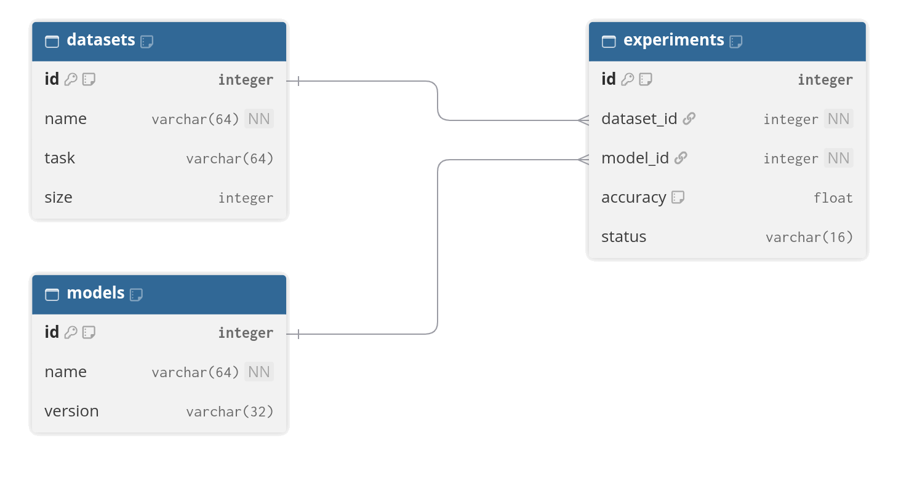
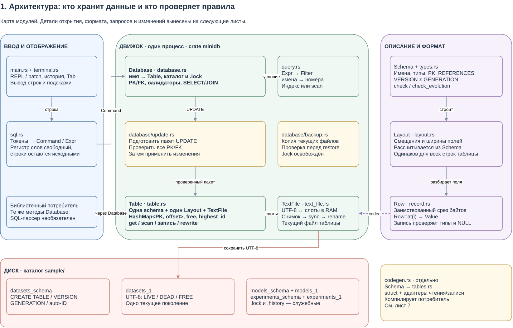
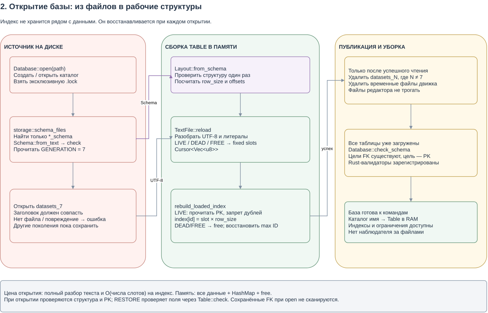
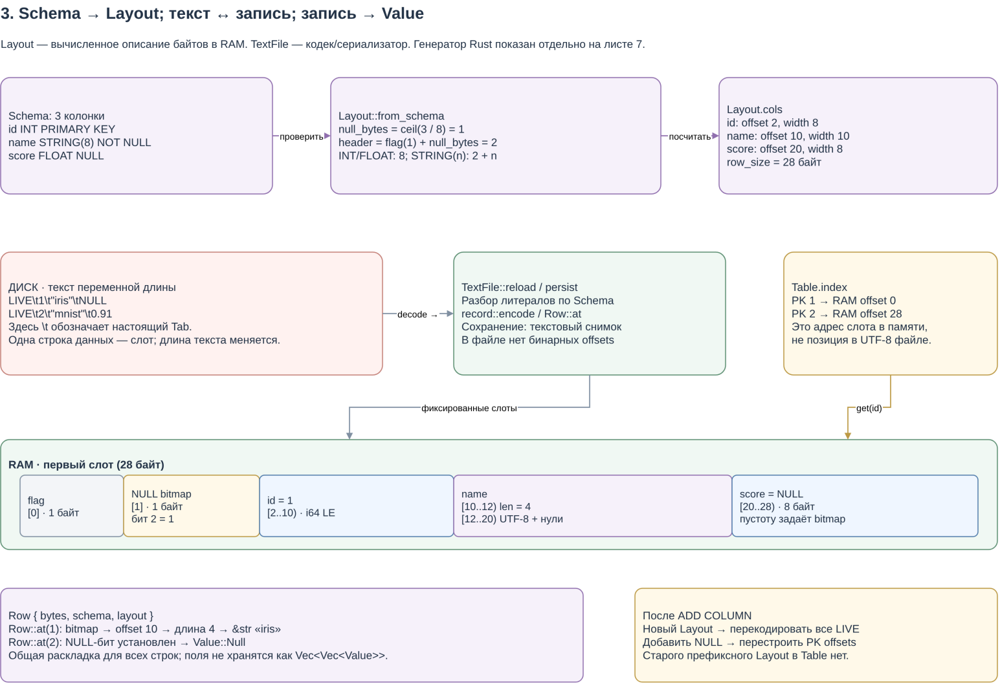
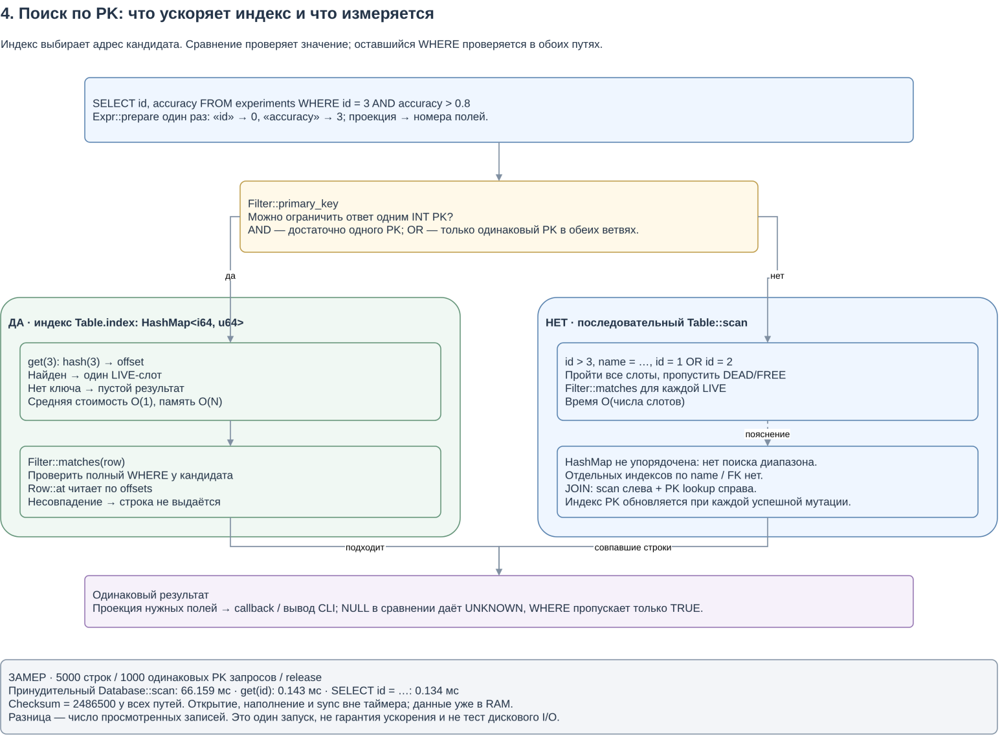
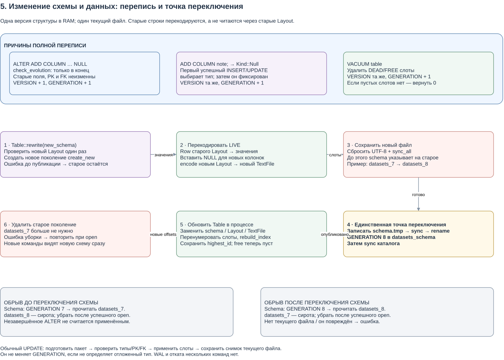
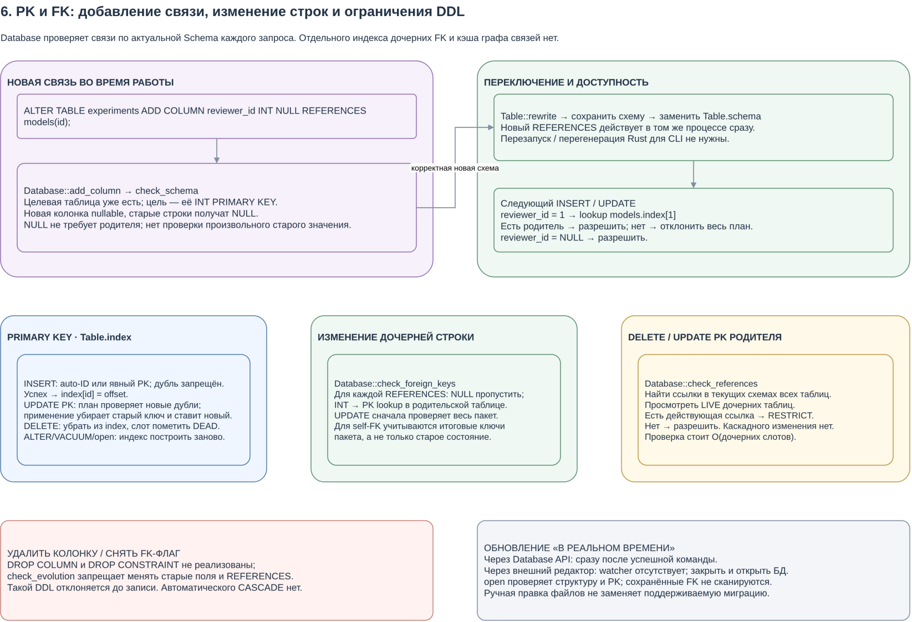
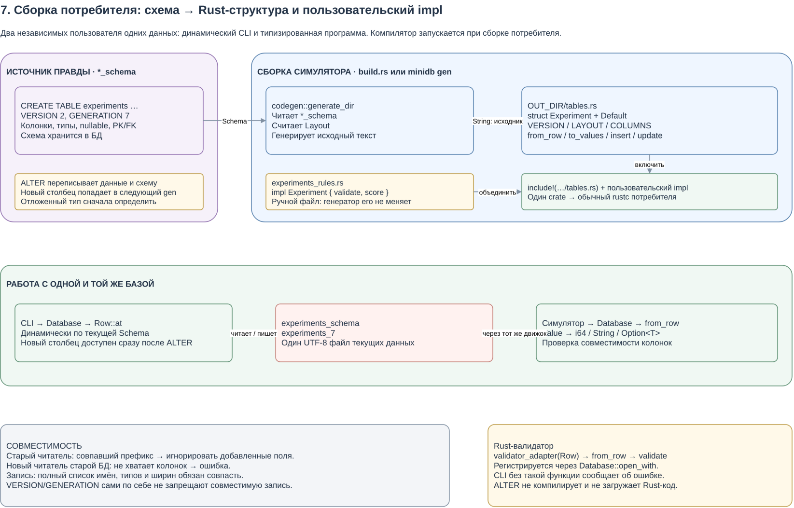

# MiniDB

Лабораторная работа №1: собственная файловая мини-СУБД на Rust.
Основная ветка — `main`; прежняя бинарная реализация сохранена в `binary`.
Рабочие данные — читаемые UTF-8 файлы. Готовые СУБД, ORM и JSON-хранилища не используются.

## Запуск

Нужен Rust/Cargo 1.89+ либо Docker Compose. Внешних Rust-зависимостей нет.

```sh
./run.sh sample
```

В `sample/` уже находятся **5 datasets, 5 models и 20 experiments**.
Первые три experiments совпадают с примером ТЗ. Консоль показывает абсолютный путь базы.
`./run.sh` без аргументов открывает тот же `sample/`.

Создать отдельную базу для защиты:

```sh
./sample.sh scratch/defense
./run.sh scratch/defense
```

`sample.sh` создаёт новый каталог и отказывается перезаписывать существующий.
Пустую базу можно создать командой `./run.sh scratch/empty` или `OPEN 'scratch/empty';`.
Справка: `./run.sh --help`, внутри консоли — `HELP;`.

### Docker

```sh
docker compose build
docker compose run --rm minidb sh /usr/local/bin/sample.sh /data/defense
docker compose run --rm minidb minidb /data/defense
```

Наполнение выполняется один раз. Для повторного открытия нужна только последняя команда.
Том `minidb-data` сохраняет базу между контейнерами. CLI работает от пользователя без root.
Команды SQL вводятся в этой же консоли; `OPEN`, `BACKUP`, `RESTORE`, `ALTER`, `VACUUM`
и генератор Rust также работают внутри контейнера:

```sh
docker compose run --rm minidb minidb gen /data/defense --out /data/generated
docker compose run --rm minidb minidb-bench /data/bench 5000
```

Полная автоматическая проверка Docker без затрагивания рабочей базы:

```sh
bash scripts/check-docker.sh
```

Скрипт создаёт отдельный проект Compose и удаляет только собственный тестовый том.
Он проверяет все команды, данные 5/5/20, CRUD, фильтры, JOIN, ошибки PK/FK,
ALTER, VACUUM, backup/restore, уборку поколений и сохранность после перезапуска.

## Таблицы и связи

| Таблица | Поля |
| --- | --- |
| datasets | id, name, task, size |
| models | id, name, version |
| experiments | id, dataset_id, model_id, accuracy, status |

`id` — INT PRIMARY KEY с авто-ID при NULL/пропуске. Повторные ключи отклоняются.
`experiments.dataset_id` ссылается на `datasets.id`, `model_id` — на `models.id`.
Несуществующие FK запрещены; удаление родителя со ссылками также запрещено (RESTRICT).



[DBML для dbdiagram.io](docs/schema.dbml). Точные типы и ограничения — в `sample/*_schema`.
Типы: INT (i64), FLOAT (f64), STRING(n) (до n байт UTF-8); есть NULL/NOT NULL и MIN/MAX.

## Сценарий защиты

После создания `scratch/defense` выполните:

```sql
SHOW DATABASE;
SHOW TABLES;
DESCRIBE experiments;
INSERT INTO datasets (name, task, size) VALUES ('demo', 'classification', 43);
SELECT * FROM datasets;
SELECT id, name FROM datasets WHERE size >= 100;
SELECT id, accuracy FROM experiments
WHERE accuracy >= 0.88 AND (status = 'completed' OR id = 3);
SELECT experiments.id, datasets.name
FROM experiments INNER JOIN datasets ON experiments.dataset_id = datasets.id;
UPDATE datasets SET size = 44 WHERE name = 'demo';
DELETE FROM datasets WHERE name = 'demo';
INSERT INTO experiments VALUES (NULL, 999, 1, 0.9, 'running');
EXIT;
```

Последний INSERT должен показать ошибку FK. Затем заново запустите
`./run.sh scratch/defense` и выполните `SELECT * FROM experiments;`:
остаются 20 записей, ошибочная строка не сохранена. Созданные таблицы переживают перезапуск.
Для демонстрации собственного CREATE:

```sql
CREATE TABLE notes (id INT PRIMARY KEY, name STRING(64) NOT NULL, score FLOAT);
INSERT INTO notes (name, score) VALUES ('test', 0.9);
ALTER TABLE notes ADD COLUMN comment STRING(128) NULL;
UPDATE notes SET comment = 'saved' WHERE id = 1;
DELETE FROM notes WHERE id = 1;
VACUUM notes;
BACKUP first;
RESTORE first TO 'scratch/restored';
```

DELETE удаляет строки; без WHERE — все строки таблицы. DROP COLUMN не реализован.
ADD COLUMN разрешён только в конец с допуском NULL. Без заданного типа новый столбец
остаётся NULL до первого успешного ненулевого INSERT/UPDATE, затем его тип фиксируется.
При ошибке CLI сразу показывает пример команды. Регистр ключевых слов свободный;
содержимое строк и путей сохраняется. Сравнения: `=`, `!=`, `>`, `<`, `>=`, `<=`;
также AND/OR, NOT, IS NULL / IS NOT NULL. JOIN: INT слева → PK справа.

## Хранение и архитектура

```text
sample/
  datasets_schema     CREATE TABLE, VERSION, GENERATION, счётчик auto-ID
  datasets_1          текущие данные datasets, UTF-8
  models_schema
  models_1
  experiments_schema
  experiments_1
  .lock               одна открытая база — один процесс
```

Откройте [datasets_1](sample/datasets_1) в IDE: строки LIVE/DEAD/FREE, поля через Tab,
строки в кавычках, управляющие символы экранированы. Для ручной правки закройте CLI.
У каждой таблицы один текущий файл данных; его номер берётся только из GENERATION в схеме.

ALTER переписывает живые строки, добавляя NULL, увеличивает VERSION и GENERATION.
VACUUM убирает удалённые слоты и увеличивает только GENERATION; если убирать нечего,
возвращает 0. Выбор типа отложенного столбца также перестраивает данные в новом поколении.
Сначала синхронизируется новый файл, затем атомарно заменяется схема и синхронизируется
каталог. После этого старый файл удаляется. При открытии удаляются осиротевшие поколения
и служебные временные файлы. Потеря текущего файла даёт ошибку.

- `sql.rs` разбирает команды; `main.rs` исполняет их и выводит результат.
- `Database` проверяет PK/FK и валидаторы, выполняет выборку, JOIN и backup/restore.
- `Table` хранит один Layout, список свободных слотов и индекс `id → offset`.
- `TextFile` декодирует UTF-8 в слоты в RAM; обычный CRUD атомарно сохраняет тот же файл.
- `Layout` и `Row` задают внутренние смещения и чтение значений.

SELECT с равенством PK использует индекс и проверяет оставшееся условие.
Другие условия просматривают живые слоты; диапазоны и разные ключи через OR требуют просмотра.
UPDATE возвращает число фактически изменённых строк. Предел подготовленного пакета — 16 МиБ.
Многооператорных транзакций и WAL нет; восстановление поколений относится к полной перезаписи.
Старый формат сегментов не читается. Прежняя `sample` сохранена локально в
`scratch/sample-before-generations`; её живые данные перенесены в новый формат.

### Открытие и представление записей

При открытии `Database` блокирует каталог, читает `*_schema` и файл указанного
поколения. `TextFile` разбирает текст в `Cursor<Vec<u8>>`: все записи в памяти имеют
фиксированный размер. Затем `Table` проходит слоты и строит PK-индекс, список свободных
слотов и максимум auto-ID. Только после успешного чтения убираются сироты.
Структура и PK проверяются при открытии. При проверке временной копии RESTORE
вызывает `Table::check` для типов и ограничений полей. Аудита всех сохранённых FK
при открытии нет: они проверяются при операциях через Database API.

Три преобразования выполняют разные задачи:

| Преобразование | Модуль | Что получается |
| --- | --- | --- |
| Текст схемы → Schema | `sql::stored_schema`, `schema.rs` | Колонки, ограничения, VERSION и GENERATION |
| Schema → Layout | `layout.rs` | NULL-bitmap, ширины и смещения полей в RAM |
| UTF-8 ↔ слоты в RAM | `text_file.rs`, `record.rs` | Читаемые файлы на диске и быстрый `Row::at(i)` |
| Schema → исходник Rust | `codegen.rs` | Структура и адаптеры для сборки другой программы |

Например, для `id INT, name STRING(8), score FLOAT NULL` Layout занимает 28 байт:
флаг — 1, NULL-bitmap — 1, id — 8, name — 2 байта длины + 8 байт текста,
score — 8. Смещения полей: 2, 10 и 20. `Row` заимствует срез слота;
`Row::at(1)` проверяет NULL-бит и читает строку сразу по смещению 10.
Это рабочее представление в памяти. Текст на диске имеет переменную длину,
поэтому адрес из PK-индекса нельзя использовать как позицию в UTF-8 файле.

### Индекс и сравнение поиска

В каждой таблице есть один `HashMap<i64, u64>`: PK → смещение слота **в RAM**.
Он не сохраняется отдельным файлом. Построение при открытии — O(числа слотов),
память индекса — O(числа живых записей). INSERT добавляет ключ, DELETE удаляет,
UPDATE ключа заменяет его; ALTER/VACUUM перестраивают адреса после уплотнения.

Сравнение (`id = 3`) — проверка значения, а индекс — способ найти кандидата.
Полный просмотр проверяет WHERE у всех живых записей: O(числа слотов).
Индекс по равенству INT PK находит один слот в среднем за O(1), после чего
проверяется **весь** WHERE. Это сохраняет правильность `id = 3 AND accuracy > 0.8`.
OR использует этот путь только при одном и том же PK в обеих ветвях.
HashMap не поддерживает упорядоченные диапазоны; `id > 3`, разные PK через OR
и условия по другим колонкам требуют просмотра. JOIN просматривает левую таблицу
и ищет совпадения по PK-индексу правой; отдельных FK-индексов нет.

### FK после ALTER и границы изменения схемы

```sql
ALTER TABLE experiments ADD COLUMN reviewer_id INT NULL REFERENCES models(id);
UPDATE experiments SET reviewer_id = 1 WHERE id = 1;
```

Сначала проверяется, что цель существует и является INT PRIMARY KEY.
ALTER переписывает старые строки с `reviewer_id = NULL`, публикует новую схему
и заменяет её в открытой `Table`. Следующий INSERT/UPDATE сразу проверяет новую
связь: NULL допустим, ненулевой FK обязан существовать в PK-индексе родителя.
Перезапуск CLI для этого не нужен. Ошибка FK отклоняет подготовленный UPDATE
до записи его строк. При DELETE или смене PK родителя движок читает текущие
схемы дочерних таблиц и ищет действующие ссылки полным просмотром: RESTRICT.
Каскадного удаления или обновления нет.

`DROP COLUMN` и снятие `REFERENCES`/`DROP CONSTRAINT` не реализованы.
`check_evolution` запрещает изменение старых колонок и их FK; такая операция
не является поддерживаемым ALTER. Автоматического наблюдения за файлами нет:
изменения через API видны сразу, внешние правки требуют закрытия и повторного открытия.

Схемы ниже разделены по вопросам: общая архитектура, открытие, Layout/кодек,
поиск, перепись, ключи и сборка потребителя. Стрелки показывают передаваемые данные
и зависимости; цветные области отделяют диск, рабочую память и сборку.

<!-- architecture:start -->



[Исходник drawio](docs/architecture/01-architecture.drawio)

<details><summary>2. Открытие базы: из файлов в рабочие структуры</summary>



[Исходник drawio](docs/architecture/02-open.drawio)

</details>

<details><summary>3. Schema → Layout; текст ↔ запись; запись → Value</summary>



[Исходник drawio](docs/architecture/03-layout.drawio)

</details>

<details><summary>4. Поиск по PK: что ускоряет индекс и что измеряется</summary>



[Исходник drawio](docs/architecture/04-select.drawio)

</details>

<details><summary>5. Изменение схемы и данных: перепись и точка переключения</summary>



[Исходник drawio](docs/architecture/05-rewrite.drawio)

</details>

<details><summary>6. PK и FK: добавление связи, изменение строк и ограничения DDL</summary>



[Исходник drawio](docs/architecture/06-keys.drawio)

</details>

<details><summary>7. Сборка потребителя: схема → Rust-структура и пользовательский impl</summary>



[Исходник drawio](docs/architecture/07-codegen.drawio)

</details>

<!-- architecture:end -->

## Реализовано по ТЗ

Статусы относятся к функциям; итоговую оценку выставляет преподаватель.
Уровни накопительные, строки таблицы не суммируются.

| ТЗ | Команды / материалы | Выполнено полностью |
| --- | --- | --- |
| 4: CREATE, INSERT, собственные файлы и перезапуск | `CREATE TABLE …; INSERT INTO …; EXIT;`, повторный `./run.sh` | Да |
| 5: SELECT и шесть сравнений | `SELECT id FROM experiments WHERE accuracy >= 0.88;` | Да |
| 6: полный CRUD | `INSERT`, `SELECT`, `UPDATE`, `DELETE` в сценарии защиты | Да |
| 7: PK/авто-ID, запрет дублей, INT/STRING/FLOAT, ошибки | `DESCRIBE experiments;`, повторный INSERT с тем же id | Да |
| 8: три связанные таблицы, CLI, FK, данные 5/5/20 | `./sample.sh новый_каталог`, неверный FK в сценарии | Да |
| 9: INNER JOIN, AND/OR, проекция, схема, архитектура и README | Примеры выше, [скриншот](docs/schema.png), [drawio](docs/architecture/) | Да |
| 10: индекс, сравнение поиска, backup/restore, воспроизводимость | Команда замера ниже; `BACKUP first; RESTORE first TO 'scratch/restored';` | Да |
| 11: SQL-like парсер, автотесты и генераторы | `cargo test --locked --offline --all-targets`, `minidb gen` | Да |
| 12: инженерное расширение — Docker и восстановление поколений | `bash scripts/check-docker.sh`, тесты обрыва переключения | Да: функции проверяются указанными сценариями |
| Сдача: исходники, GitHub, данные, README, PDF | [sample](sample/), [отчёт на 2 страницы](docs/report.pdf), `git remote -v` | Нет: остаётся отправить репозиторий и указать ссылку GitHub |

## Проверки и отчёт

```sh
cargo test --locked --offline --all-targets
cargo clippy --locked --offline --all-targets -- -D warnings
cargo fmt --all -- --check
cargo run --locked --offline --release --example bench -- scratch/bench 5000
```

Последняя команда нужна для сравнения индекса по ТЗ на 10 баллов и для PDF-отчёта.
Открытие, наполнение и sync исключены из замера; сравниваются scan, get и SELECT по PK
в RAM на одинаковых запросах с проверкой контрольных сумм. Это не замер дискового I/O.
Результат одного запуска — [CSV](docs/benchmark.csv): 5000 строк, 1000 одинаковых
запросов по PK, release; контрольная сумма всех способов — 2486500.

| Способ поиска | Время 1000 запросов, мс |
| --- | ---: |
| Принудительный полный просмотр `scan` | 66.159 |
| PK-индекс `get(id)` | 0.143 |
| `SELECT … WHERE id = …` | 0.134 |

В этом запуске прямой PK-поиск быстрее полного просмотра примерно в 463 раза:
он рассматривает один слот вместо всех. Числа зависят от машины; небольшая разница
между `get` и SELECT — шум единичного замера, а не преимущество SELECT.
[PDF на две страницы](docs/report.pdf) содержит ту же схему таблиц, формат хранения,
сценарий операций, результаты сравнения и ограничения реализации.
Раздел 5 ТЗ прямо требует PDF с результатами benchmark индекса.
Отчёт пересобирается: `python3 scripts/make_report.py` (нужен pycairo).

## Генератор и документация

```sh
cargo run --locked --offline -- gen sample --out scratch/generated
cargo run --locked --offline --manifest-path examples/simulator/Cargo.toml -- scratch/simulator
```

Генератор читает `*_schema` и выдаёт struct, VERSION, LAYOUT, from_row/to_values,
insert/update и Default. Старый читатель допускает совместимый префикс и игнорирует добавленные поля.
Потребитель, собранный с большим числом полей, не читает более старую БД: проверка
сообщает об отсутствующих колонках. После ALTER старые строки физически дополнены NULL,
поэтому новый потребитель получает для nullable-полей `None`. Запись требует
совпадения колонок, типов и ширин. VERSION/GENERATION не сравниваются на равенство.
Пользовательские методы находятся в отдельном impl; пример с build.rs —
[examples/simulator](examples/simulator/). Rustc запускает потребитель при сборке.
Нативные VALIDATOR используются через `Database::open_with`; CLI их не обходит.
Исходники архитектуры находятся в `docs/architecture`, результаты экспорта — в `diagrams`.

[Справка команд](docs/COMMANDS.md) автоматически получается из `minidb --help`:
`bash scripts/generate-commands.sh`. [Первый workflow](.github/workflows/commands.yml)
обновляет её, [второй](.github/workflows/drawio-to-png.yml) экспортирует drawio и обновляет
раздел схем этого README. Ручной запуск обоих — `workflow_dispatch`.

```sh
act workflow_dispatch --bind -W .github/workflows/commands.yml -j commands \
  -P ubuntu-latest=catthehacker/ubuntu:act-24.04
act workflow_dispatch --bind -W .github/workflows/drawio-to-png.yml -j diagrams \
  -P ubuntu-latest=catthehacker/ubuntu:act-24.04
```

Нужен Docker. В act используются локальные файлы, checkout и отправка коммита
пропускаются; сборка, экспорт и генерация документации выполняются полностью.
